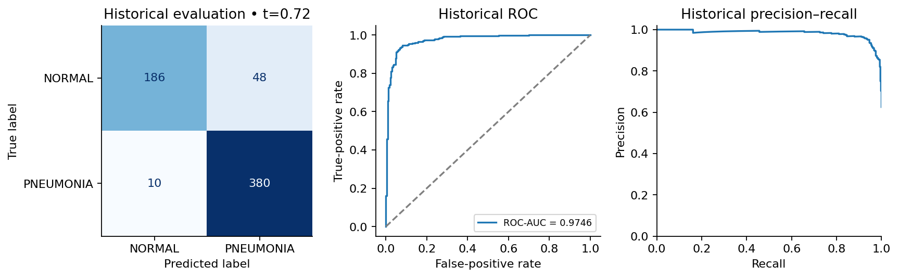
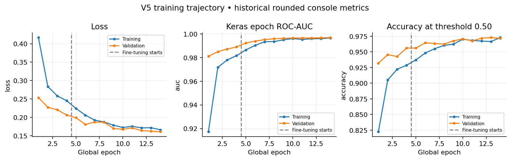
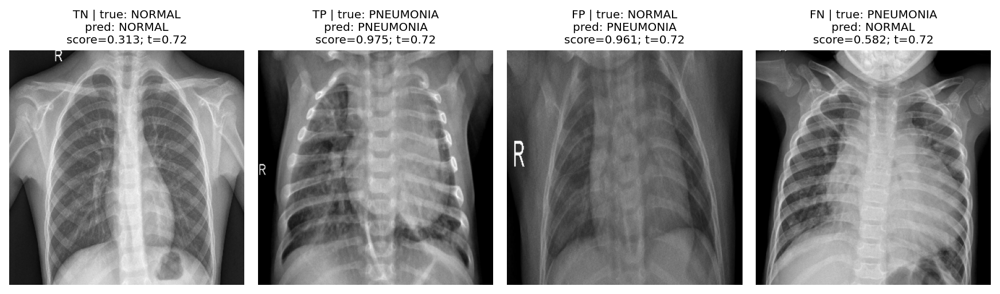

# Chest X-Ray Pneumonia Classification V5

[](https://colab.research.google.com/github/BensuVarol/chest-xray-pneumonia-gradcam/blob/main/notebook/Chest_XRay_Pneumonia_GradCAM.ipynb)

## Project Overview

A Python and TensorFlow/Keras biomedical image analysis code sample for academic review. The notebook demonstrates data-integrity auditing, grouped validation, transfer learning, operating-point selection, quantitative error analysis and Grad-CAM. It is a research prototype with no established clinical utility. The original 55-cell development record is preserved unchanged in `archive/`.

The [latest user-supplied viewing notebook](notebook/Chest_XRay_Pneumonia_GradCAM.ipynb) replaces the older notebook at its established GitHub path. It is preserved byte for byte. For local execution from the project root, use the matching [execution companion](Chest_XRay_Pneumonia_V5_Final_Research.ipynb). The default mode verifies the saved V5 model and generates predictions without training. Clone or download the **complete repository**, including `assets/`, `archive/` and `requirements.txt`; opening a notebook alone in Colab does not fetch these dependencies.

Both published notebooks have the **same 32 cell sources in the same order and the same eight embedded figures**. The supplied viewing copy has cleared execution counters; the execution companion retains the genuine 1–16 counters and timing metadata from the recorded local CPU run. Neither is presented as a new Colab execution. See [repository update provenance](evidence/repository_update.json) and [the preserved execution evidence](evidence/fresh_execution.json).

## Dataset

Images come from [Chest X-Ray Images (Pneumonia), Kaggle](https://www.kaggle.com/datasets/paultimothymooney/chest-xray-pneumonia). Class order is NORMAL = 0, PNEUMONIA = 1. Supplied folders contain 5,216 training, 16 unused validation and 624 historical-test files. V5 uses **3,781 fitting / 956 validation / 624 historical-test images** after documented quarantine and exact-duplicate removal.

Raw data are excluded from this project. Download through KaggleHub or supply a directory containing `train/`, `val/` and `test/`. The upstream [Kermany, Zhang and Goldbaum data record](https://data.mendeley.com/datasets/rscbjbr9sj/2) lists CC BY 4.0. See [THIRD_PARTY_NOTICES.md](THIRD_PARTY_NOTICES.md) for attribution, example-image transformations and the precise rights-check boundary.

## Methodology

The notebook hashes actual image bytes, checks saved manifests and reconstructs the stratified group split with seed 314. Filename proxies connected by identical bytes are grouped; components overlapping historical-test proxies/bytes are excluded before splitting. The final pairs share no paths, exact hashes or filename proxies. These checks do **not** establish clinical patient/site independence or exclude near-duplicates.

## Model Architecture

EfficientNetV2B0 with documented ImageNet initialization, built-in preprocessing, global average pooling, dropout 0.40 and a sigmoid classifier. Input is RGB float32, bilinear-resized to 320 × 320, pixels 0–255; no external division by 255. Aspect ratio is not preserved. The saved model is float32. Architecture and resolution are design choices without a controlled ablation proving superiority.

## Training and Evaluation

Original training used four head epochs at Adam 0.001, then ten fine-tuning epochs at 0.00001, training-only augmentation, fitting-only class weights and label smoothing 0.04. Batch normalization stayed frozen. The last 160 backbone layers were considered; enabled layer flags include weightless layers and must not be interpreted as a count of trainable convolutional layers.

Checkpoint selection and the final threshold use validation. Final selection requires empirical precision and recall ≥0.95, then ranks specificity, higher threshold and F1 on the 0.01–0.99 grid, returning **0.72**. These are project selection criteria, not clinical guarantees. Training accuracy uses 0.50. Training curves are recovered from rounded original logs; they are not new training or native original History objects. Optional fresh-training code is explicitly disabled and has not been execution-tested in this review.

## Results

The preserved V5 verification run recomputed these results from archived predictions and reproduced them through saved-model image inference. This GitHub update rechecks the available artifacts and prediction arithmetic; it does not repeat training or claim another image-inference run. These are **historical benchmark results**, not an untouched independent test:

| Measure | Grouped validation: 956 files | Historical benchmark: 624 files |
|---|---:|---:|
| Decision threshold | 0.72 | 0.72 |
| TN / FP / FN / TP | 267 / 2 / 34 / 653 | 186 / 48 / 10 / 380 |
| Accuracy | 96.2343% | 90.7051% |
| Pneumonia precision | 99.6947% | 88.7850% |
| Pneumonia recall / sensitivity | 95.0509% | 97.4359% |
| Specificity | 99.2565% | 79.4872% |
| Pneumonia F1 | 97.3174% | 92.9095% |
| ROC-AUC | 0.99695351 | 0.97456717 |

The 618-unique-byte supplement gives TN/FP/FN/TP = 185/46/10/377, accuracy 90.9385% and ROC-AUC 0.97460765; full metrics are in the notebook. Six extra repeated files have no conflicting exact-byte labels. All 48 false positives and 10 false negatives are exported, including threshold distances and descriptive IM/NORMAL2 group rates.

## Grad-CAM

Figures show deterministic TN/TP/FP/FN examples with the target class, score and threshold. Heatmaps are coarse relative explanations, not lesion annotations or proof of clinical correctness. Marker/neck attention is retained and discussed rather than hidden. There is no causal shortcut test, localization validation or explanation sanity-check study.

## Recorded figures

The images below are the saved, full-resolution figures from the completed verification run. The original eight embedded notebook figures match between the supplied view copy and the execution companion. [Browse all results and their scope](results/README.md).

### Historical benchmark: confusion matrix and curves



### Training trajectory from original rounded console logs

These are historical 14-epoch observations (4 head + 10 fine-tuning), not a new training run. Accuracy in these curves uses threshold 0.50; the final operating threshold is 0.72.



### True and false prediction examples



Grad-CAM examples: [TN](results/20261022T185949_703755Z/TN_gradcam.png), [TP](results/20261022T185949_703755Z/TP_gradcam.png), [FP](results/20261022T185949_703755Z/FP_gradcam.png), [FN](results/20261022T185949_703755Z/FN_gradcam.png). These qualitative maps are not lesion annotations or proof that the model uses clinically valid features.

## Limitations

V1 selected a threshold using test predictions; V2–V4 reused this benchmark during development. V5's validation-selected threshold does not make its historical test untouched. Patient/site independence, near-duplicates, score calibration, label reliability and external generalization remain unresolved. Historical precision is below 95%, despite meeting the validation selection floor. The next scientific step is a fixed-model, fixed-threshold evaluation on an appropriate genuinely independent cohort. No independent clinical performance or novelty claim is made.

## Reproducibility Instructions

Use Python 3.12 in an isolated environment. From the extracted project root:

```powershell
python -m venv .venv
.venv\Scripts\python -m pip install -r requirements.txt
.venv\Scripts\python analysis\execute_notebook.py
```

On Linux/macOS, use `.venv/bin/python` instead. The runner starts a fresh kernel and saves real outputs. KaggleHub downloads public data when no local path is configured; complete any provider authentication or terms flow normally. For an existing dataset, append `--dataset-root /path/to/chest_xray` or set `CONFIG['dataset_root']`. Relative image filenames are dataset-relative, and project assets/results use project-relative paths. Personal absolute paths are omitted from shared outputs; the original archive remains unchanged.

For **Colab**, upload/extract the entire project bundle into the runtime, install `requirements.txt`, restart after dependency changes, open the notebook and set `CONFIG['project_root']` to the extracted project folder. Uploading the notebook alone is insufficient. The same input pipeline is portable Python/TensorFlow code; a second Colab end-to-end execution was not performed in this final check. The optional canonical-tree downloader is documented in its script and retrieval evidence.

Recorded saved-model verification on **22 October 2026**: **16/16 code cells, zero error outputs, 86.5 seconds**, a new kernel in the dedicated pinned environment, Python 3.12.14, CPU. This check reused the previously created clean verification environment; it did not repeat installation or training. Maximum score differences from original predictions were 1.41e-06 on validation and 1.34e-06 on historical test, with identical classifications and metrics. Model reload difference was zero. See `evidence/fresh_execution.json` and `results/latest_run.json`.

Independent lightweight checks after installation:

```powershell
.venv\Scripts\python analysis\verify_archived_predictions.py
.venv\Scripts\python analysis\verify_project.py
.venv\Scripts\python analysis\verify_submission.py
```

## Repository Structure and Sharing

```text
notebook/Chest_XRay_Pneumonia_GradCAM.ipynb  # exact latest user-supplied view copy
Chest_XRay_Pneumonia_V5_Final_Research.ipynb
README.md
requirements.txt
technical_audit_report.md   # Turkish final audit and readiness decision
THIRD_PARTY_NOTICES.md
.gitignore
assets/                    # required saved model, CSVs, policies and manifests
archive/                   # unchanged development record
analysis/                  # execution and verification scripts
evidence/                  # checksums, cell inventory and execution evidence
results/                   # completed runs; latest_run.json selects the current one
```

`assets/selected_model.keras` is **23.50 MiB** and is included in the review bundle with SHA-256 verification. It can be kept as an ordinary Git file at this size. If later hosted separately, supply a real accessible download location and preserve the filename/checksum; no nonexistent release URL is provided. Raw data, environments and caches are excluded. Upload the extracted project files rather than committing the ZIP. File-size guidance: [GitHub documentation](https://docs.github.com/en/repositories/working-with-files/managing-large-files/about-large-files-on-github). No repository, release, public permissions or open-source licence was created or changed by this preparation.

## GitHub update verification

The supplied notebook, execution companion, required assets and original archive have matching source/artifact checksums. The repository includes the single required 23.50 MiB inference model; it excludes raw data, environments, caches and ZIP archives. Three lightweight verification scripts are rechecked for this update without training. The precise checks and published-file hashes are recorded separately from the preserved 22 October execution evidence.
